# Cartify E-Commerce Website

## University Project Report

Cartify is a responsive e-commerce website for browsing a product catalogue, managing a shopping cart, and completing a demo checkout. It includes a customer account area, email-based authentication and verification, and a role-protected administration area. The project is implemented as a React frontend and a Node.js/Express API that stores application data in MongoDB.

> **Scope note:** This report describes features and routes found in the project source. Checkout uses a demo payment flow; it does not charge a real payment card.

## 1. Project Introduction

Cartify provides a single online storefront for everyday products across categories such as electronics, fashion, home, beauty, sports, and accessories. Visitors can search and browse products, view product details and reviews, and add products to a cart. Customers can create verified accounts, manage their orders and saved items, and use the checkout flow. Administrators have a separate protected area for managing the catalogue, customers, orders, promotions, and reviews.

The application has two main parts:

- **Frontend:** a React single-page application built and served with Vite.
- **Backend:** a REST API built with Express. It uses MongoDB through Mongoose for persistent data.

## 2. Project Objectives

- Provide a clear, responsive storefront for browsing and searching products.
- Support product details, categories, best sellers, reviews, and wishlists.
- Allow customers to manage a cart and submit an order through a validated checkout.
- Provide account registration, email verification, login, password recovery, and optional two-factor authentication.
- Protect customer and administrator features according to authentication and role.
- Store catalogue, account, cart, address, review, and order data in MongoDB.
- Demonstrate a practical frontend/backend architecture with automated tests.

## 3. Technologies Used

| Area | Technologies | Purpose |
| --- | --- | --- |
| Frontend | React 18, React Router 7, JavaScript, CSS | User interface, client-side state, and page navigation |
| Frontend tooling | Vite 8, npm | Development server and production bundling |
| Backend | Node.js, Express 4 | REST API and server-side business rules |
| Database | MongoDB, Mongoose 8 | Persistent application data and document models |
| Authentication | JSON Web Tokens, `bcryptjs`, HTTP-only refresh cookie | Sign-in, session refresh, password hashing, and protected routes |
| Validation and protection | Zod, Helmet, CORS, `express-rate-limit`, request sanitization | Input checks, browser security headers, origin control, and request throttling |
| Email | Nodemailer with Brevo SMTP or the Brevo API fallback | Account verification, password recovery, and OTP delivery |
| Testing | Vitest, Testing Library, Supertest | Frontend component/flow tests and backend API tests |
| Linting | ESLint | Backend code-quality checks |

## 4. System Requirements

| Requirement | Minimum / recommendation |
| --- | --- |
| Operating system | Windows, macOS, or Linux |
| Node.js | Node.js 20.19 or later, or Node.js 22.12 or later (Vite 8-compatible runtime) |
| npm | npm compatible with the selected Node.js release |
| Database | MongoDB running locally or a reachable MongoDB connection string |
| Browser | Current desktop or mobile browser with JavaScript enabled |
| Email service | Brevo SMTP or API credentials when real email OTP delivery is required |
| Network | Internet access for package installation and any remote email delivery |

## 5. Website Features

### Storefront and catalogue

- Homepage sections for featured products, categories, best sellers, and promotions.
- Shop page with catalogue browsing, search, filters, and sorting.
- Dedicated categories and best-sellers pages.
- Product detail pages with product information, stock availability, and reviews.
- Product review submission for signed-in customers; reviews can be moderated by an administrator.
- Responsive navigation, product cards, cart count, and toast notifications.

### Cart and orders

- Guest cart data is kept in browser storage; it can be merged into a customer account after sign-in.
- Signed-in cart data is stored by the backend.
- Cart item quantities can be updated and items removed.
- Checkout requires an authenticated customer and validates delivery/contact details.
- The backend recalculates prices, discounts, shipping, and totals when creating an order.
- Customers can view order history and cancel eligible orders.
- A guest order lookup endpoint is available when a guest order is created.

### Customer account

- Registration and email verification.
- Login, logout, session refresh, and sign-out from all sessions.
- Profile and password updates.
- Password recovery using an emailed verification code.
- Account overview, orders, saved addresses, wishlist, and security settings.
- Optional email-based two-factor authentication for login.

### Administration

- Administrator-only dashboard and activity log.
- Product and category management.
- Order status management.
- Customer account management.
- Coupon management.
- Review moderation.

## 6. Website Structure and Pages

### Storefront routes

| Route | Page / purpose | Access |
| --- | --- | --- |
| `/` | Home page | Public |
| `/shop` | Shop and product catalogue | Public |
| `/categories` | Category browsing | Public |
| `/best-sellers` | Best-selling products | Public |
| `/product/:slug` | Product details and reviews | Public |
| `/cart` | Shopping cart | Public |
| `/contact` | Contact page | Public |
| `/order-confirmation/:orderId` | Order confirmation/details | Order lookup/access rules apply |
| `/login` | Customer or administrator sign-in | Public |
| `/login/2fa` | Second-factor code entry during sign-in | Public flow |
| `/register` | Account registration | Public |
| `/verify-email` | Registration email verification | Public flow |
| `/forgot-password` | Request password recovery | Public |
| `/reset-password` | Reset password with verification code | Public flow |
| `/checkout` | Checkout | Signed-in customer |
| `/account` | Customer account overview | Signed-in customer |
| `/account?tab=orders` | Orders tab within the account page | Signed-in customer |
| `/account?tab=addresses` | Saved addresses tab | Signed-in customer |
| `/account?tab=wishlist` | Wishlist tab | Signed-in customer |
| `/account?tab=security` | Account security settings | Signed-in customer |
| `*` | Not-found page | Public |

The account overview and its tabs are sections of one `/account` route, not separate profile, orders, or wishlist URLs.

### Administration routes

All administration pages require a signed-in user with the administrator role.

| Route | Page |
| --- | --- |
| `/admin` | Dashboard |
| `/admin/orders` | Order management |
| `/admin/products` | Product management |
| `/admin/customers` | Customer management |
| `/admin/reviews` | Review moderation |
| `/admin/coupons` | Coupon management |
| `/admin/activity` | Activity log |

## 7. Project Folder Structure

The tree below shows the main source and documentation files. Installed dependencies and generated build output are omitted.

```text
Cartify ecommerce/
├── README.md
├── CONTINUE_HERE.txt
├── docs/
│   └── screenshots/              Actual desktop and mobile PNG captures
├── frontend/
│   ├── public/images/            backpack, camera, chair, headphones, hero, laptop,
│   │                              perfume, promo, smartwatch, sneakers, speaker,
│   │                              sunglasses, tote-bag, yoga-mat images
│   ├── src/
│   │   ├── components/           AuthShell, Benefits, BestSellers, Categories,
│   │   │                          FeaturedProducts, Footer, Hero, Icons, Navbar,
│   │   │                          Newsletter, OrderSummary, PageIntro, ProductCard,
│   │   │                          ProductReviews, PromoBanner, RouteGuards,
│   │   │                          SectionHeading, Toast (JSX and related CSS)
│   │   ├── context/              AuthContext, CartContext, CatalogContext,
│   │   │                          SearchContext, ToastContext, WishlistContext
│   │   ├── data/                 delivery.js, products.js
│   │   ├── layouts/              SiteLayout.jsx
│   │   ├── pages/                Home, Shop, Categories, BestSellers, Product,
│   │   │                          Cart, Checkout, OrderConfirmation, Contact,
│   │   │                          Account, Login, Register, TwoFactor, VerifyEmail,
│   │   │                          ForgotPassword, ResetPassword, NotFound
│   │   │   └── admin/            AdminActivity, AdminCoupons, AdminCustomers,
│   │   │                          AdminDashboard, AdminLayout, AdminOrders,
│   │   │                          AdminProducts, AdminReviews, AdminUI
│   │   ├── services/             api.js, orders.js, storage.js
│   │   ├── test/                 cart, cartSync, checkout, checkoutAuth, homepage,
│   │   │                          orders, product, reviews, routing, shop,
│   │   │                          staticPages, wishlist tests; setup and render helper
│   │   ├── utils/                checkoutValidation, formatCurrency, id, money,
│   │   │                          payment, redirect, validation
│   │   ├── App.jsx, index.css, main.jsx
│   ├── index.html
│   ├── package.json
│   └── vite.config.js
├── backend/
│   ├── src/
│   │   ├── config/               constants, database, env
│   │   ├── controllers/          address, admin, auth, cart, catalog, order,
│   │   │                          review, wishlist controllers
│   │   ├── data/                 seedCatalog.js
│   │   ├── middleware/           auth, errors, rateLimits, requestId, roles,
│   │   │                          sanitize, validate
│   │   ├── models/               ActivityLog, Address, Cart, Category, Coupon,
│   │   │                          Order, Otp, Product, RefreshSession, Review,
│   │   │                          User, Wishlist
│   │   ├── routes/               address, admin, auth, cart, catalog, order,
│   │   │                          review, wishlist routes
│   │   ├── scripts/              seed.js
│   │   ├── services/             activity, cart, email, order, OTP, pricing,
│   │   │                          product, review, token services
│   │   ├── utils/                ApiError, asyncHandler, crypto, money,
│   │   │                          response, serializers
│   │   └── validators/           address, admin, auth, cart, catalog, order,
│   │                              review validators
│   ├── tests/                    admin, auth, emailService, orders tests,
│   │                              helpers, mailbox, and test setup
│   ├── .env.example              Safe environment-variable template
│   ├── index.js                 Backend entry point
│   └── package.json
└── mockup/                       Three Cartify UI PNG mockups, one ShopNest
                                  showcase PNG, and web 4.pdf; not app routes
```

## 8. Frontend and Backend Architecture

### Frontend

The frontend is a React single-page application. React Router maps browser URLs to page components, and shared providers keep common state available throughout the site:

- `AuthContext` manages the signed-in user and authentication actions.
- `CartContext` manages the cart and synchronizes it with the API for signed-in users.
- `CatalogContext` and `SearchContext` provide catalogue and search state.
- `WishlistContext` manages saved products.
- `ToastContext` displays user feedback.

The service layer contains API and storage helpers. Vite serves the frontend during development and proxies `/api` requests to `http://localhost:5000`. Product images are served from `frontend/public/images`.

### Backend

The Express application applies request IDs, security headers, compression, CORS, JSON parsing, cookies, sanitization, and rate limiting before routing requests. Route modules connect request paths to controllers; controllers call services and Mongoose models. Validation schemas check incoming data. Shared middleware handles authentication, administrator authorization, missing routes, and errors.

The backend listens on port `5000` by default. `GET /api/health` reports API/database readiness.

## 9. Database Design and API Endpoints

### Database design

MongoDB stores documents through Mongoose models. The implemented model set is:

| Model | Main purpose |
| --- | --- |
| `User` | Customer and administrator identity, password hash, verification/2FA status, and account state |
| `Product` | Product catalogue, pricing, stock, and product details |
| `Category` | Product category records |
| `Cart` | A customer's saved cart and product quantities |
| `Wishlist` | A customer's saved products |
| `Address` | Customer delivery addresses and default-address selection |
| `Order` | Contact/shipping details, item snapshots, calculated totals, payment-demo status, and status history |
| `Review` | Customer product ratings and review moderation status |
| `Coupon` | Promotion codes and discount configuration |
| `Otp` | Hashed one-time verification codes, expiry, attempt, and resend information |
| `RefreshSession` | Refresh-token/session records |
| `ActivityLog` | Recorded administrative activity |

Orders reference their customer when present and their catalogue products, while saving item and price snapshots for order history. Guest orders can be stored without a user reference.

### API endpoint groups

The following paths are mounted by the Express application. `:name` denotes a route parameter.

| API group | Implemented endpoints | Access |
| --- | --- | --- |
| Health | `GET /api/health` | Public |
| Authentication | `POST /api/auth/register`, `/verify-email`, `/resend-otp`, `/login`, `/login/2fa`, `/refresh`, `/logout`, `/forgot-password`, `/reset-password`; `GET /api/auth/me`; `PATCH /api/auth/profile`; `POST /api/auth/change-password`, `/logout-all`, `/cart/merge`, `/2fa/enable/request`, `/2fa/enable/confirm`, `/2fa/disable/request`, `/2fa/disable/confirm`, `/2fa/resend` | Public or signed-in depending on endpoint |
| Catalogue | `GET /api/products`, `/api/products/:reference`, `/api/categories`, `/api/brands` | Public |
| Cart | `GET /api/cart`; `POST /api/cart`; `PATCH /api/cart/:productId`; `DELETE /api/cart/:productId`, `/api/cart` | Signed-in |
| Orders | `POST /api/orders`; `GET /api/orders`, `/api/orders/:publicId`; `POST /api/orders/:publicId/cancel`, `/api/orders/guest/:publicId` | Checkout supports optional authentication; customer history requires sign-in; guest lookup is rate-limited |
| Addresses | `GET`, `POST /api/addresses`; `PATCH`, `DELETE /api/addresses/:addressId`; `POST /api/addresses/:addressId/default` | Signed-in |
| Wishlist | `GET /api/wishlist`; `POST`, `DELETE /api/wishlist/:productId` | Signed-in |
| Reviews | `GET /api/reviews/product/:reference`, `/api/reviews/mine`; `POST /api/reviews`; `DELETE /api/reviews/:reviewId` | Public product reviews; customer-specific operations require sign-in |
| Administration | `GET /api/admin/dashboard`, `/users`, `/users/:userId`, `/orders`, `/orders/:publicId`, `/products`, `/categories`, `/coupons`, `/reviews`, `/activity`; `POST /api/admin/products`, `/categories`, `/coupons`; `PATCH /api/admin/users/:userId`, `/orders/:publicId/status`, `/products/:productId`, `/categories/:categoryId`, `/coupons/:couponId`, `/reviews/:reviewId/status`; `DELETE /api/admin/products/:productId`, `/categories/:categoryId`, `/coupons/:couponId`, `/reviews/:reviewId` | Administrator |

The backend performs authoritative checkout pricing. It does not trust the browser to provide final item prices or totals.

## 10. Authentication, OTP, and 2FA

- New accounts are verified using an email-delivered one-time code.
- Login uses a password and can require a second email OTP when two-factor authentication is enabled.
- Customers can request a password-reset code and submit a new password with that code.
- Authenticated users can request and confirm enabling or disabling email-based 2FA.
- Passwords are hashed using `bcryptjs`. OTP codes are also stored as hashes rather than readable codes.
- OTPs expire and have configurable resend delays, hourly request limits, and maximum verification attempts.
- Access tokens are used for authenticated API requests; refresh sessions use an HTTP-only cookie.
- Email is sent by Brevo SMTP when configured, with a Brevo API fallback. Without working email credentials, OTP delivery is not simulated as successful.

Default OTP lifetime and request limits are configurable through the backend environment variables described below.

## 11. Screenshots of Website Pages

Screenshots in this section were captured from the running Cartify application, not from the design mockups. Desktop captures use a `1440 × 1000` browser viewport. Mobile captures use a `390 × 844` viewport.

### Desktop screenshots

**Figure 1. Home Page.** The landing page introduces the collection and links to the shop and categories.

<p align="center">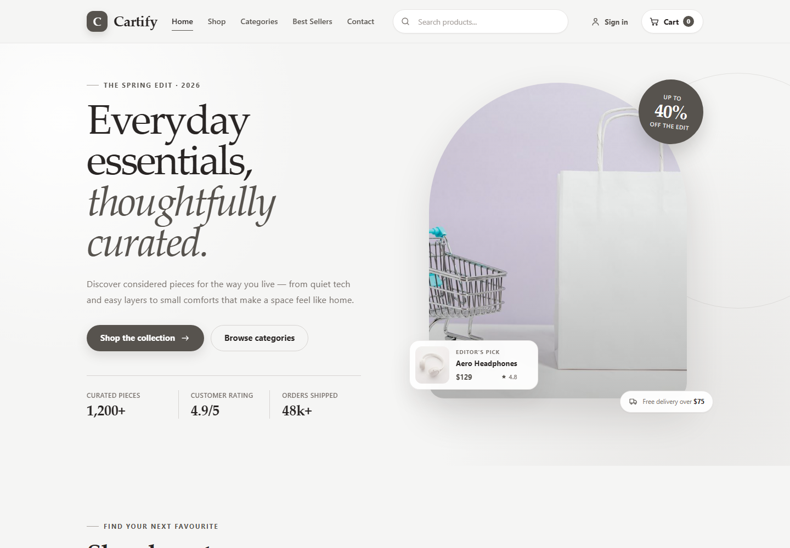</p>

**Figure 2. Shop Page.** The public product catalogue and its browsing controls.

<p align="center">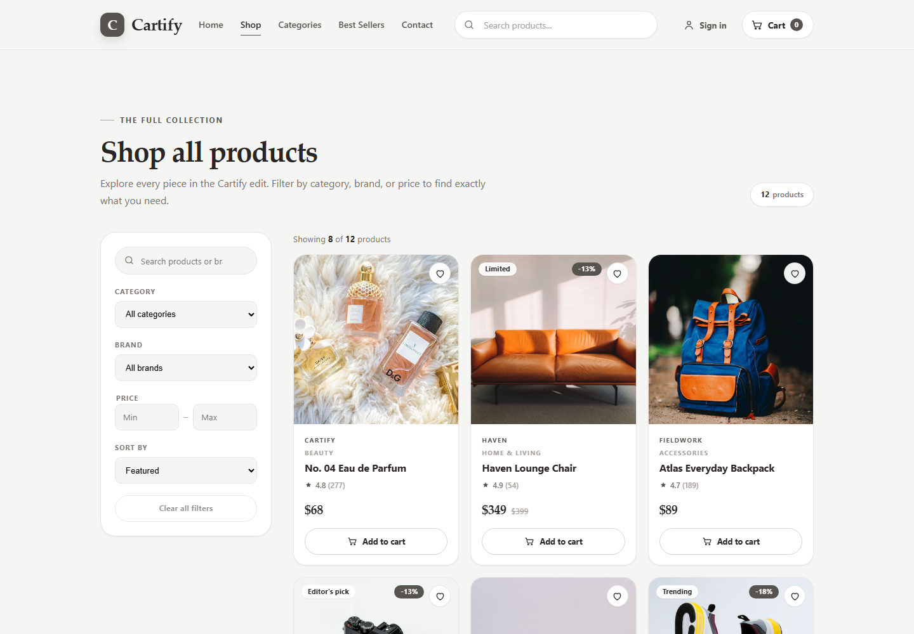</p>

**Figure 3. Categories Page.** Available product categories.

<p align="center">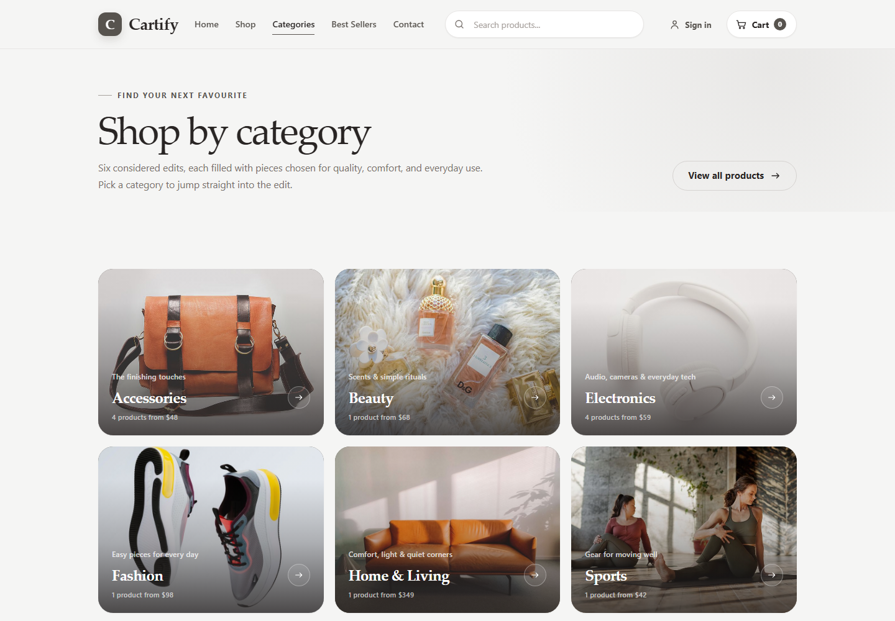</p>

**Figure 4. Best Sellers Page.** The dedicated best-selling product collection.

<p align="center">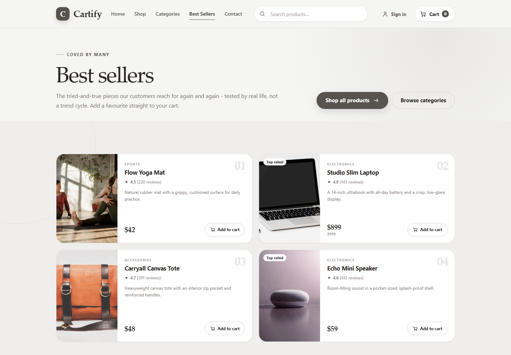</p>

**Figure 5. Product Details Page.** Product information, price, and purchase/review areas for a catalogue item.

<p align="center">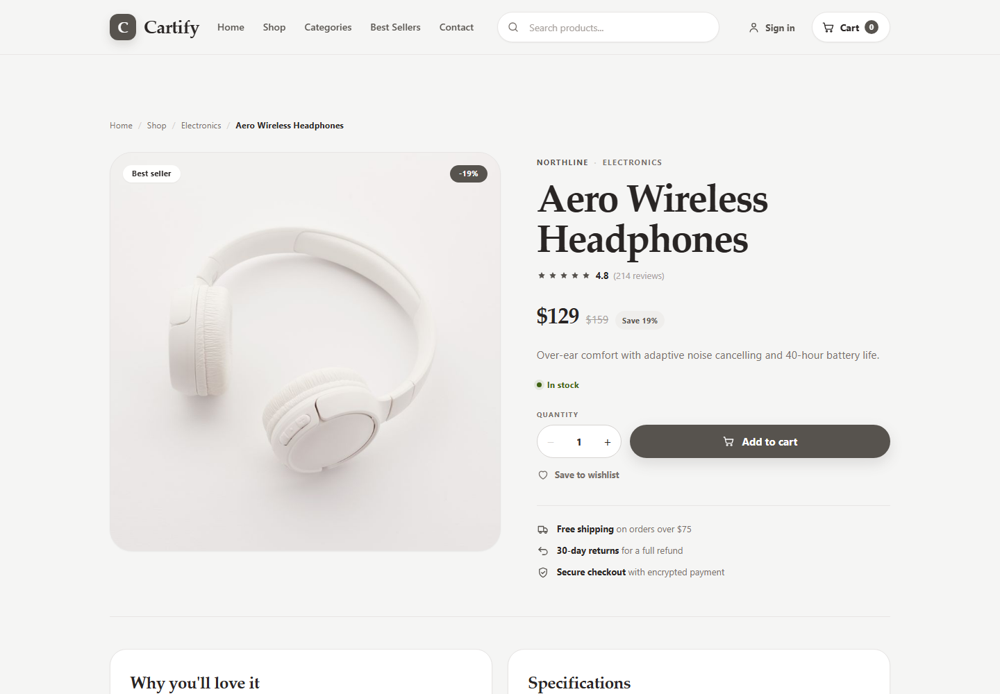</p>

**Figure 6. Cart Page.** The current cart and its checkout action.

<p align="center">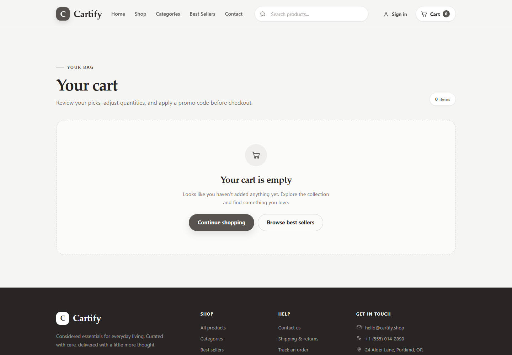</p>

**Figure 7. Login Page.** The sign-in form for customers and administrators.

<p align="center">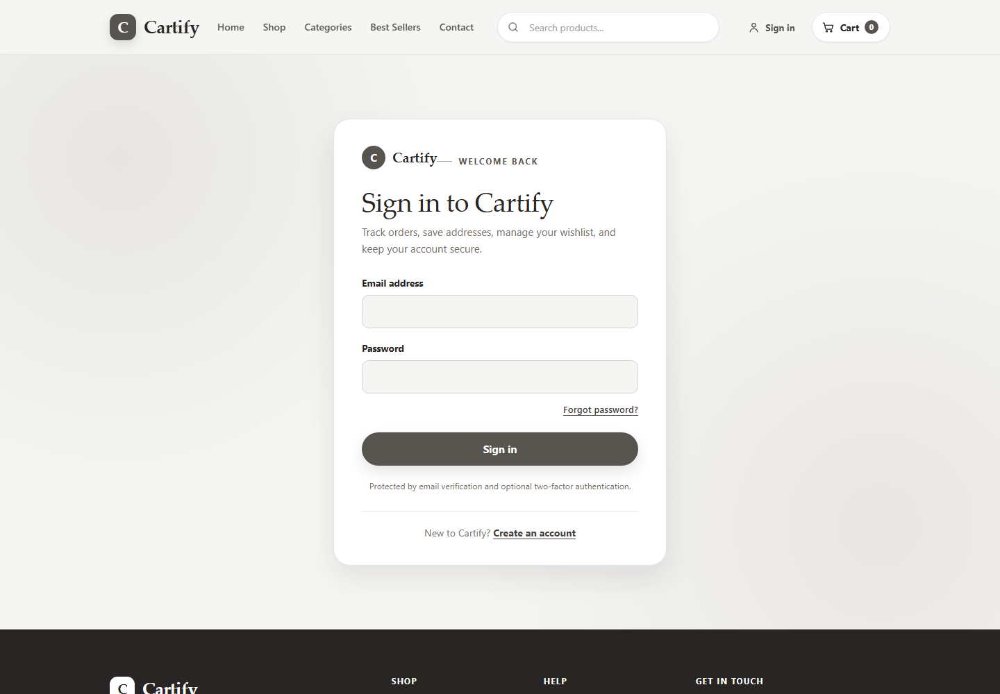</p>

**Figure 8. Registration Page.** The public new-account registration form.

<p align="center">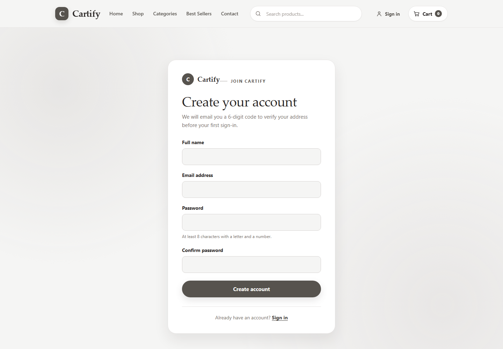</p>

**Figure 9. OTP Verification Page.** The email-code verification screen.

<p align="center">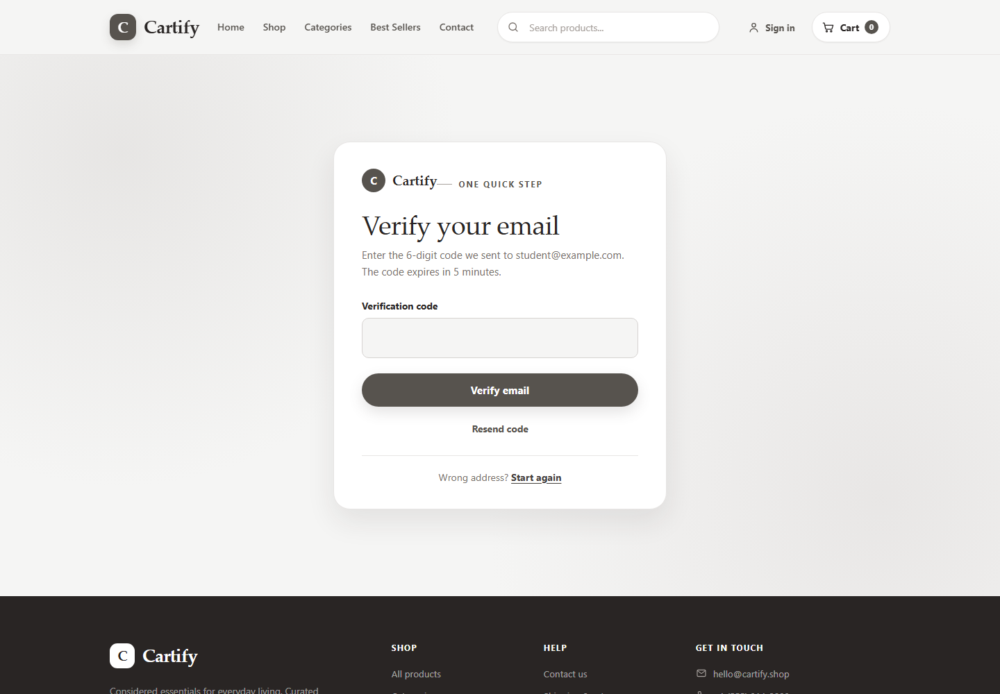</p>

**Figure 10. Contact Page.** The public contact page.

<p align="center">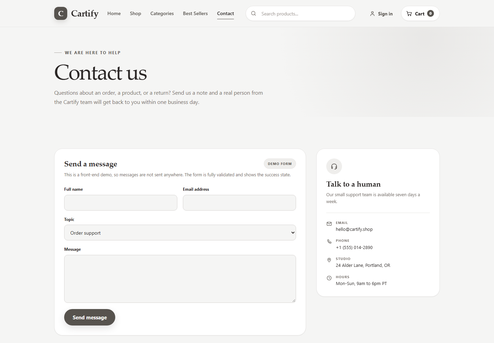</p>

### Mobile screenshots

**Figure 11. Home Page (mobile).** Responsive home layout at a narrow viewport.

<p align="center">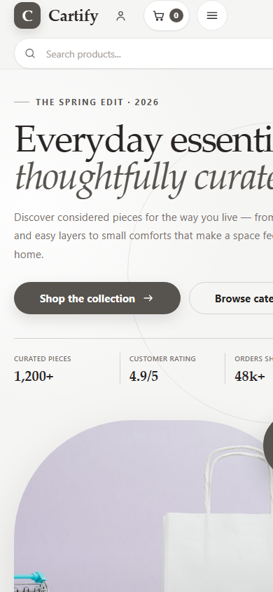</p>

**Figure 12. Shop Page (mobile).** Responsive catalogue browsing.

<p align="center">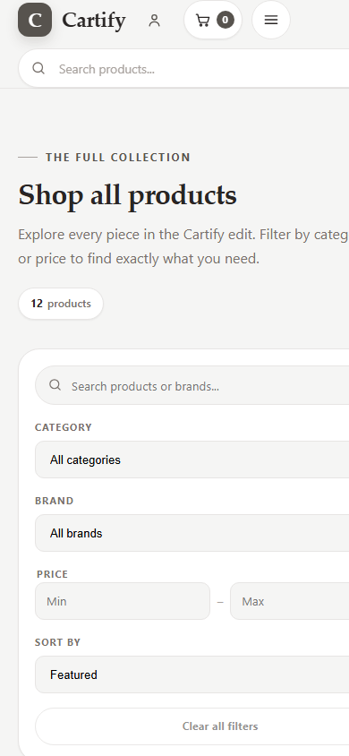</p>

**Figure 13. Product Details Page (mobile).** Responsive product details view.

<p align="center">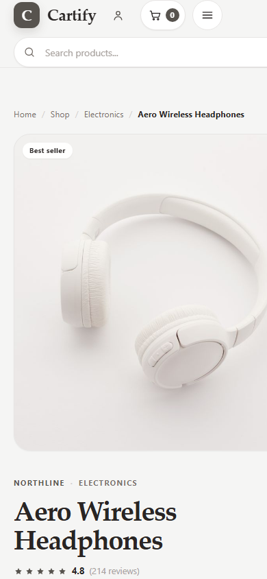</p>

**Figure 14. Cart Page (mobile).** Responsive cart view.

<p align="center">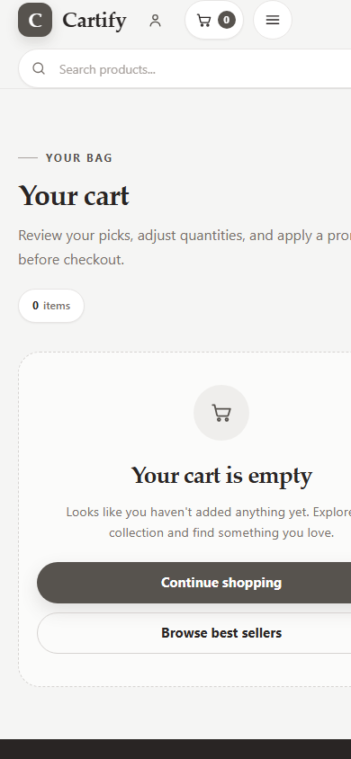</p>

### Screenshots not included

The following requested screenshots were not captured because they require a valid order or an authenticated customer/administrator session. No placeholders or mockups are used in their place:

- **Checkout Page** — requires a signed-in customer.
- **Order Confirmation Page** — requires a real order ID created by a successful checkout.
- **Customer Dashboard / Profile Page / Orders Page / Wishlist Page** — these are account sections and require a signed-in customer. The account sections share the `/account` route; Orders and Wishlist are tabs, not separate page routes.
- **Admin Dashboard / Product Management / Order Management** — require a signed-in administrator.

To complete this screenshot set, capture those screens in a running project after signing in with a prepared customer/admin account and, for order confirmation, placing a test order. Do not include real customer personal data in submitted screenshots.

## 12. Installation and Setup Instructions

1. Install Node.js and npm, and make sure MongoDB is available locally or through a connection string.
2. Open one terminal at the project root and configure the backend:

   ```powershell
   Set-Location backend
   npm install
   Copy-Item .env.example .env
   ```

3. Edit `backend/.env` for the local MongoDB connection and a unique development JWT secret. Configure Brevo SMTP/API settings if email OTPs must be delivered. Set the administrator seed details to values you control; do not commit `.env`.
4. Seed the catalogue, sample promotion, and administrator account:

   ```powershell
   npm run seed
   ```

5. In a second terminal at the project root, install frontend dependencies:

   ```powershell
   Set-Location frontend
   npm install
   ```

The frontend has no `.env` file by default. During Vite development, `/api` requests are proxied to `http://localhost:5000`.

## 13. Environment Variables

All private backend settings belong in `backend/.env`. The checked-in `.env.example` contains placeholders only; replace them with appropriate local values and do not publish secrets.

| Variable | Purpose |
| --- | --- |
| `NODE_ENV` | Backend mode: development, test, or production |
| `PORT` | API listening port; defaults to `5000` |
| `CLIENT_ORIGINS` | Comma-separated frontend origins allowed by CORS |
| `MONGODB_URI` | MongoDB connection string |
| `JWT_ACCESS_SECRET` | Secret used to sign access tokens; production requires a unique secret of at least 32 characters |
| `JWT_ACCESS_EXPIRES_IN` | Access-token lifetime; defaults to `15m` |
| `JWT_REFRESH_EXPIRES_DAYS` | Refresh-session lifetime in days; defaults to `7` |
| `COOKIE_SECURE` | Set to `true` when the backend is served over HTTPS |
| `SMTP_HOST`, `SMTP_PORT`, `SMTP_SECURE` | SMTP server configuration |
| `SMTP_USER`, `SMTP_PASS` | Brevo SMTP login and key |
| `BREVO_API_KEY` | Optional Brevo API fallback credential |
| `BREVO_SENDER_EMAIL`, `BREVO_SENDER_NAME` | Verified sender details |
| `OTP_TTL_MINUTES` | OTP validity period; defaults to `5` |
| `OTP_RESEND_SECONDS` | Minimum delay between code requests; defaults to `60` |
| `OTP_MAX_ATTEMPTS` | Maximum incorrect code attempts |
| `OTP_MAX_PER_HOUR` | Maximum code requests per email and purpose per hour |
| `ADMIN_NAME`, `ADMIN_EMAIL`, `ADMIN_PASSWORD` | Values used by the seed script to create the administrator |
| `RATE_LIMIT_DISABLED` | Rate-limit override intended only for controlled testing |

For a separately hosted frontend, `VITE_API_URL` can be set as a **build-time** frontend environment variable to point at the API. Do not put backend secrets in frontend variables; values prefixed with `VITE_` are exposed to browser code.

## 14. How to Run the Project

Start MongoDB first. In one terminal, run the API:

```powershell
Set-Location backend
npm run dev
```

In another terminal, run the frontend:

```powershell
Set-Location frontend
npm run dev
```

Open `http://localhost:5173` in a browser. The backend runs at `http://localhost:5000`; its health endpoint is `http://localhost:5000/api/health`.

For a production frontend bundle, run `npm run build` in `frontend`. The generated files are written to `frontend/dist`. `npm start` in `backend` starts the API without the development file watcher.

## 15. Testing and Build Results

The following checks were run for this report:

| Check | Command | Result |
| --- | --- | --- |
| Frontend tests | `cd frontend; npm run test:run` | Passed: 12 test files, 73 tests |
| Backend tests | `cd backend; npm test` | Passed: 4 test files, 22 tests |
| Frontend production build | `cd frontend; npm run build` | Passed: Vite production bundle generated in `frontend/dist` |
| Backend lint | `cd backend; npm run lint` | Passed: ESLint reported no errors |

The frontend tests cover page rendering/routing and key catalogue, cart, checkout, review, and wishlist behaviors. Backend tests cover authentication, OTP/email service behavior, orders, and administration. Backend tests use the configured test database and test mailer.

## 16. Security and Limitations

### Implemented protections

- Passwords are hashed using bcrypt and excluded from normal user serialization.
- OTP records contain a hash of the code, expire, and enforce attempt and resend limits.
- Refresh tokens are handled through an HTTP-only cookie.
- Protected routes verify authentication; admin routes also check the administrator role.
- Request schemas, sanitization, CORS origin checks, security headers, and rate limiting are applied by the API.
- Checkout totals are recalculated by the backend. The order model stores only a payment-demo status and limited card metadata, not a full card number or CVC.

### Limitations

- Payment is in demo/test mode. A real payment provider and its secure payment/3-D Secure flow are not implemented.
- Real email verification and OTP delivery require working Brevo SMTP or API credentials.
- MongoDB must be available for persistent API behavior and the backend test suite.
- Mobile screenshots at a 390-pixel viewport show horizontal overflow and clipped content in parts of the home, shop, and cart layouts. These views need additional responsive-layout testing.
- The screenshot set excludes authenticated account/admin views and a real order-confirmation page; see Section 11.
- The `mockup/` folder contains design references and is not part of the running website.

## 17. Conclusion

Cartify demonstrates an end-to-end e-commerce application with a responsive React storefront, an Express API, MongoDB persistence, customer authentication, OTP-based verification, a protected administrator area, and automated tests. The project supports the main browsing, cart, order, review, and management flows. It is suitable as a university software project and demonstration. A production deployment would still need a live payment integration, configured email delivery, production-grade secrets and HTTPS, and deployment-specific monitoring and operations.

## 18. GitHub Repository Link

**Repository URL:** Not available in the provided project folder. The folder has no Git repository metadata or configured remote, so a repository URL cannot be verified. Add the public or private GitHub URL here when one is available.
